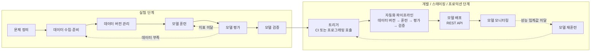
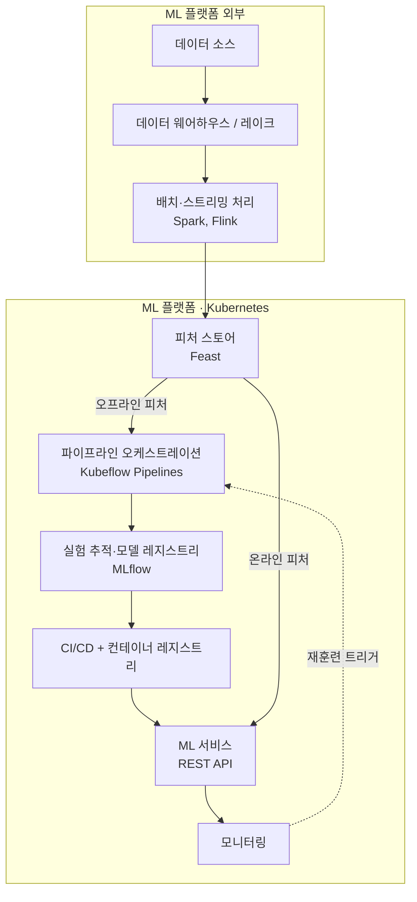
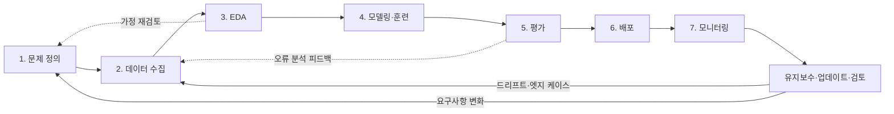
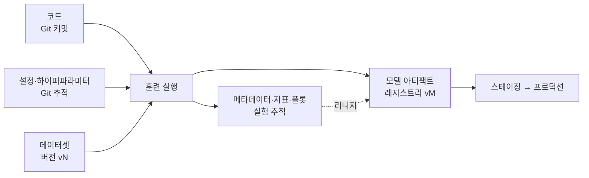
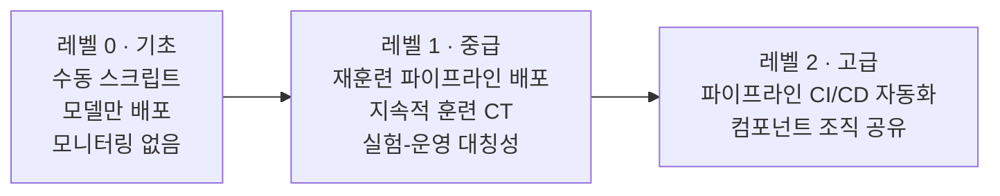
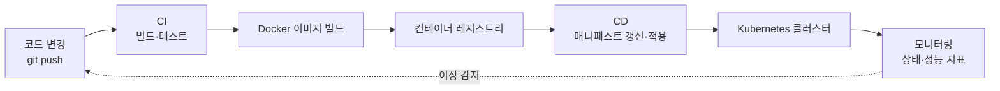
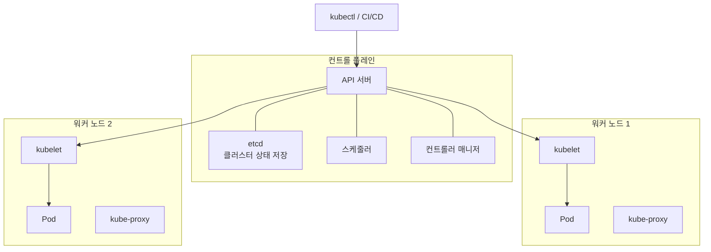
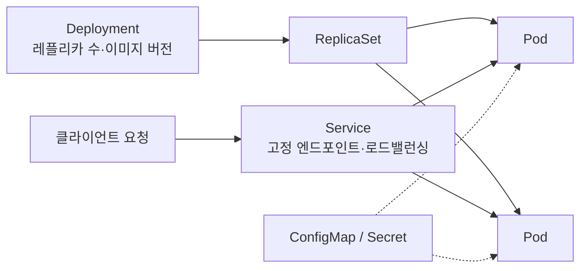

---
# CH1. MLOps와 ML 엔지니어링 시작

### 한 줄 요약

ML 프로젝트는 한 번 배포하고 끝나는 일이 아니라 실험과 운영을 반복하는 수명주기이며, 이를 안정적으로 돌리려면 파이프라인·피처 스토어·모델 레지스트리·배포 자동화를 갖춘 ML 플랫폼이 필요하다.

 

### 주요 내용

- **ML 수명주기는 두 단계로 나뉜다.**
  - **실험 단계**: 문제 정의 → 데이터 수집·준비 → 데이터 버전 관리 → 모델 훈련 → 평가 → 검증. 화살표는 한 방향이지만 실제로는 거의 모든 단계에서 되돌아가므로, 처음부터 오케스트레이션 파이프라인으로 묶어 자동화한다.
  - **개발/스테이징/프로덕션 단계**: 실험 파이프라인을 완전히 자동화하고 끝에 **모델 배포**를 붙인다. 배포 후에는 부하 테스트, 오토스케일링, 버전 관리와 롤백 전략, **모니터링**(시스템 지표 + 드리프트 + 비즈니스 지표), **재훈련**(정기 또는 임계값 기반 트리거)이 이어진다.
- **첫 질문은 "ML이 꼭 필요한가"** 이다. 휴리스틱으로 충분히 풀리면 ML이라는 만능 망치를 꺼내지 않는다. 휴리스틱은 ML이 넘어야 할 baseline 역할도 한다.
- **데이터도 코드처럼 버전 관리해야 재현성이 보장된다.** 다만 데이터는 Git처럼 표준화된 도구가 아직 없다.
- **ML 엔지니어 필요 역량**: 소프트웨어 배포·디버깅 경험, 주요 프레임워크(PyTorch, TensorFlow, scikit-learn) 활용, 데이터 엔지니어링, 자동화와 실험 재현성. 처음부터 다 알 필요는 없고 하나씩 쪼개서 익힌다.
- **ML 플랫폼을 직접 구축한다.** 쿠버네티스 위에 다음 도구를 단계적으로 조립한다. SageMaker·Vertex AI 같은 벤더 플랫폼이 있어도 직접 조립해 보는 경험이 한계를 극복하는 역량이 된다.
  - Kubeflow Pipelines: 파이프라인 오케스트레이션
  - Feast: 피처 스토어
  - MLflow: 실험 추적, 모델 레지스트리
  - 컨테이너 레지스트리 + CI/CD: 모델 배포 자동화
- **MLOps는 LLMOps로 확장된다.** 같은 토대 위에 벡터 DB, 가드레일, 비용 최적화, 프롬프트 관리가 추가된다(12~13장).
- **실습 프로젝트 3개**: OCR 신분증 탐지(이미지), 영화 추천기(테이블), RAG 문서 도우미 DakkaBot(LLM).

 

### 다이어그램

> 책의 그림을 그대로 쓰지 않고 내용을 바탕으로 재구성한 Mermaid 다이어그램입니다.

**ML 수명주기: 실험 단계 → 프로덕션 단계**

**ML 플랫폼 구성 (재구성)**

 

### 핵심 개념

| 개념 | 설명 |
| :--- | :--- |
| ML 수명주기 | 문제 정의부터 모니터링·재훈련까지 이어지는 반복 프로세스. 실험 단계와 프로덕션 단계로 나뉜다 |
| 휴리스틱 | 데이터 학습 없이 사람이 정한 규칙으로 푸는 방식. ML 도입 전 baseline으로 먼저 측정한다 |
| 데이터 버전 관리 | 데이터 변경도 모델 동작을 바꾸므로, 같은 데이터+코드로 같은 결과를 재현하기 위해 데이터 버전을 관리한다 |
| 피처 스토어 | 피처를 한 번 정의·저장해 훈련과 서빙이 같은 값을 쓰게 하는 저장소. 오프라인(훈련)·온라인(실시간 서빙) 모드로 제공해 훈련-서빙 불일치를 막는다 |
| 모델 레지스트리 | 모델과 함께 하이퍼파라미터, 메타데이터, 플롯 등 아티팩트를 기록하고 스테이징 → 프로덕션 승격을 관리한다 |
| 파이프라인 오케스트레이션 | 수명주기 각 단계를 컴포넌트로 만들고, 앞 컴포넌트의 출력을 다음 컴포넌트로 넘기며 자동 실행한다 |
| 모델 드리프트 | 운영 환경 데이터가 훈련 때와 달라지면서 모델 성능이 떨어지는 현상 |

---

## 실무 사례

> ⚠️ 가상 사례 — 의료 영상 AI 플랫폼에 1장의 수명주기를 적용해 본 시나리오입니다.

**상황과 문제**

의료 영상 판독 보조 모델을 연구팀이 노트북에서 학습해 모델 파일만 전달하고, 운영팀이 이를 수작업으로 서비스에 올리고 있다. 병원마다 장비가 달라 성능 편차가 생기지만 어떤 데이터·설정으로 만든 모델인지 추적이 안 되고, 재학습할 때마다 같은 결과가 재현되지 않는다.

 

**적용 방법**

- 데이터 전처리 → 훈련 → 평가 → 검증을 파이프라인 컴포넌트로 분리해 자동 실행한다.
- 학습 데이터셋에 버전을 붙이고, 훈련마다 데이터 버전·코드 커밋·하이퍼파라미터·지표를 MLflow에 기록한다.
- 검증을 통과한 모델만 모델 레지스트리에서 스테이징 → 프로덕션으로 승격하고, 문제 시 이전 버전으로 롤백한다.
- 운영 중에는 시스템 지표와 함께 병원·장비별 입력 분포를 모니터링해 드리프트를 감지한다.

 

**결과 또는 기대 효과**

- 기대 효과: 모델 출처 추적과 재현이 가능해지고, 배포·롤백 시간이 줄며, 장비 변화로 인한 성능 저하를 조기에 발견할 수 있다.
- 확인된 결과: 없음 (가상 시나리오)

 

---

## 나의 생각

<!-- 배운 점, 공감하거나 의문이 든 부분, 내 업무에 적용하고 싶은 점을 자유롭게 작성하세요. -->
<!-- 생각해볼 질문: 우리 조직은 실험 단계와 프로덕션 단계 중 어디에 더 많은 시간을 쓰고 있나? 휴리스틱 baseline을 먼저 측정해 본 적이 있나? -->

 
 

---

## 참고자료

- 머신러닝 플랫폼 엔지니어링 1장 (원서: *Machine Learning Platform Engineering*, Manning, 2026)
- Kubeflow Pipelines 개요: https://www.kubeflow.org/docs/components/pipelines/overview/
- Feast: https://feast.dev/ · https://docs.feast.dev/
- MLflow: https://mlflow.org/

 

---
# CH2. MLOps란 무엇인가

### 한 줄 요약

ML의 가치는 모델 하나가 아니라 문제 정의부터 유지보수까지 계속 개선되는 폐쇄 루프에서 나오며, MLOps는 데이터·실험·모델 변화를 다룬다는 점에서 DevOps와 구별된다.

 

### 주요 내용

- **ML은 루프다.** 모델·데이터·하이퍼파라미터는 일시적이고 계속 바뀌므로, 변경을 전제로 워크플로를 설계한다. 모델(가중치+네트워크)과 코드는 별개로 버전 관리하고, 둘을 잇는 **리니지**를 유지한다.
- **루프 7단계**
  - **문제 정의**: "고객 이탈 예측" 같은 문구로는 부족하다. 비즈니스·기술·법무 이해관계자별 질문으로 범위, 지표, 허용 오차, 데이터 거버넌스를 합의한다.
  - **데이터 수집**: 이 단계의 편향은 이후 모든 단계로 전파된다.
    - 관련성, 충분한 크기, 품질, 편향·누수 방지, 운영 분포 대표성, 리니지를 확보한다.
    - 기업은 연구와 달리 도메인 맞춤 데이터셋을 직접 만들어야 하는 경우가 많다.
    - 데이터셋: MIDV-500(신분증 영상 500편), CVAT 사람 애노테이션 + 합성 데이터, MovieLens 1M(조각으로 나눠 데이터 유입을 시뮬레이션)
  - **EDA**: 데이터 문제에 대한 첫 방어선이다. 스키마, 분포, 클래스 균형, 이상값, 주기성을 확인한다. 가정은 검증 전까지 리스크로 보고 파이프라인 초기에 검증 체계를 둔다.
  - **모델링·훈련**: 코드·설정·데이터를 분리한 모듈식 구조로, 모델은 그 조합의 아티팩트로 본다. 설정을 Git으로 추적하면 실험과 디버깅이 빨라진다. 단, 과도한 파라미터화는 피한다. YOLO를 신분증 탐지용으로 파인튜닝한다.
  - **평가**: 분류·탐지는 정밀도·재현율·F1, 회귀는 MAE·MSE를 쓴다. 도메인에 따라 중시하는 지표가 다르다(의료는 위양성·정밀도, 금융은 재현율). 버전 관리되는 홀드아웃 셋으로 자동 평가하고, 오류 패턴은 데이터 수집으로 피드백한다.
  - **배포**: API 엔드포인트 또는 엣지 디바이스로 배포한다. 최적화(양자화 등) 후 성능을 재검증하고, 스테이징 → 프로덕션으로 승격한다. BentoML + Yatai, RAG는 Chainlit을 쓴다.
  - **모니터링**: 데이터·성능·오류를 모니터링하고, 담당자에게 실제로 도달하는 알림 체계를 갖춘다. 드리프트 탐지와 재훈련 트리거에는 Evidently를 쓴다.
  - **유지보수·업데이트·검토**: 버그 수정, 엣지 케이스 데이터 수집, 드리프트 대응 재훈련. 루프 전체에 분산된 활동으로 본다. RAG에서는 Langfuse, 가드레일, 환각 테스트를 다룬다.
- **MLOps가 어려운 이유**: 단계마다 복잡도가 누적되고, 데이터 보안·공정성 관리가 필요하며, 직군 간 언어가 다르다. 최적화·스케일링, 지저분한 실세계 데이터, 거버넌스, 도구 파편화도 문제다. 빠른 지름길은 기술 부채로 돌아온다.
- **성숙한 조직에서의 이점**: 실험 가속, 비용 최적화, 팀 간 협업, 효율·추적성 향상, 스케일링 표준화.
- **DevOps와의 차이**: 데이터가 1급 구성요소이고, 코드 변경 없이도 모델이 바뀌며(지속적 훈련, CT), 해석 가능성·편향을 다루고, 빌드가 아닌 실험 자체를 추적한다.
- **성숙도 레벨(구글 기준)**
  - 레벨 0: 수동 스크립트, 모니터링 없음
  - 레벨 1: 재훈련 파이프라인 자체를 배포, 실험-운영 대칭성
  - 레벨 2: 파이프라인 빌드·배포까지 CI/CD 자동화

 

### 다이어그램

> 책의 그림을 그대로 쓰지 않고 내용을 바탕으로 재구성한 Mermaid 다이어그램입니다.

**ML 루프 7단계**

**모듈식 코드베이스와 리니지**

**MLOps 성숙도 레벨 (구글 기준)**

 

### 핵심 개념

| 개념 | 설명 |
| :--- | :--- |
| 리니지 | 모델이 어떤 데이터·코드·설정에서 어떤 과정을 거쳐 만들어졌는지 잇는 계보. 유지(기록)와 추적(조회)이 한 세트다 |
| 데이터 누수 | 학습 데이터에 평가용 데이터나 미래 정보가 섞여 점수가 실제보다 부풀려지는 현상 |
| 유해한 편향 | 데이터가 현실을 골고루 담지 못해 특정 상황·집단에서 모델이 일관되게 틀리는 현상 (표본·선택·과거 편향) |
| EDA | 데이터의 스키마·분포·이상값을 탐색해 가정을 검증하는 단계. 문제의 첫 방어선 |
| 홀드아웃 데이터셋 | 학습에 쓰지 않고 따로 빼둔 최종 평가용 데이터. 운영 분포를 반영하고 버전 관리한다 |
| 정밀도 / 재현율 / F1 | 양성 판정의 정확도 / 실제 양성을 찾아낸 비율 / 둘의 조화평균 |
| 지속적 훈련(CT) | 코드 변경이 없어도 새 데이터로 모델을 자동 재훈련하는 MLOps 고유 개념 |
| 실험-운영 대칭성 | 개발과 운영 환경에서 같은 파이프라인을 사용하는 성질. 성숙도 레벨 1의 핵심 |

---

## 실무 사례

> ⚠️ 가상 사례 — 의료 영상 AI 플랫폼에 2장의 루프와 평가 원칙을 적용해 본 시나리오입니다.

**상황과 문제**

흉부 X-ray 이상 소견 검출 모델이 내부 테스트에서는 F1이 높았지만, 신규 병원에 배포하자 성능이 크게 떨어졌다. 확인해 보니 같은 환자의 영상이 훈련·테스트에 모두 들어가 있었고(누수), 학습 데이터 대부분이 특정 제조사 장비에서 나온 것이었다(표본 편향).

 

**적용 방법**

- 문제 정의 단계에서 임상 담당자와 "놓치면 안 되는 소견"을 합의하고, 재현율 하한선을 평가 기준으로 정한다.
- 환자 단위로 분할해 누수를 막고, 분할 규칙과 홀드아웃 셋을 버전 관리한다.
- EDA에서 장비 제조사·병원·촬영 조건별 분포를 확인하고, 그룹별로 성능을 따로 측정한다.
- 배포 후에는 입력 영상 분포를 모니터링해 드리프트가 감지되면 재훈련을 트리거한다.

 

**결과 또는 기대 효과**

- 기대 효과: 평가 점수와 실제 성능의 괴리가 줄고, 신규 병원 도입 전에 성능 저하 위험을 미리 파악할 수 있다.
- 확인된 결과: 없음 (가상 시나리오)

 

---

## 나의 생각

<!-- 배운 점, 공감하거나 의문이 든 부분, 내 업무에 적용하고 싶은 점을 자유롭게 작성하세요. -->
<!-- 생각해볼 질문: 우리 팀은 성숙도 레벨 0~2 중 어디쯤인가? 다음 레벨로 가려면 무엇부터 자동화해야 하나? -->

 
 

---

## 참고자료

- 머신러닝 플랫폼 엔지니어링 2장 (원서: *Machine Learning Platform Engineering*, Manning, 2026)
- Google Cloud, MLOps: 머신러닝의 지속적 배포 및 자동화 파이프라인: https://cloud.google.com/architecture/mlops-continuous-delivery-and-automation-pipelines-in-machine-learning
- CVAT: https://github.com/cvat-ai/cvat
- Ultralytics YOLO 문서: https://docs.ultralytics.com/
- Evidently: https://www.evidentlyai.com/

 

---
# CH3. 쿠버네티스 위에 애플리케이션 구축하기

### 한 줄 요약

ML 플랫폼은 Docker·Kubernetes·CI/CD·모니터링이라는 DevOps 기반 위에 세워지며, 3장은 ML 전용이 아닌 이 인프라 기본기를 실습으로 다진다.

 

### 주요 내용

- **관점 전환**: 1~2장이 개념과 조직 관점이었다면, 3장부터 실습이 시작된다. 멘탈 맵의 초점이 ML 플랫폼의 기반인 쿠버네티스와 CI/CD·모니터링으로 옮겨간다.
- **ML 엔지니어의 핵심 책임 중 하나는 ML 시스템을 떠받치는 인프라를 만들고 유지하는 것**이다. 모델 배포든 파이프라인 구성이든 현대적 인프라 도구에 대한 탄탄한 기초가 필요하다.
- **다루는 범위**
  - ML 플랫폼의 인프라 뼈대 구축
  - Docker로 애플리케이션을 일관되게 컨테이너화
  - Kubernetes로 배포 오케스트레이션
  - 빌드·배포 자동화(CI/CD)
  - 프로덕션 애플리케이션의 상태·성능 모니터링
- **구성**: 3.1 컨테이너와 도구 → 3.2 Docker → 3.3 Kubernetes(아키텍처 개요, 쿠버네티스 오브젝트 등)
- **이후 연결**: 이 기반 위에 4장부터 Kubeflow 등 ML 플랫폼 컴포넌트를 얹는다.

 

### 다이어그램

> 일반적인 구조를 그린 Mermaid 다이어그램입니다. 3장 본문을 읽은 뒤 책 기준으로 보완하세요.

**빌드 → 배포 → 모니터링 흐름**

**Kubernetes 아키텍처**

**주요 쿠버네티스 오브젝트 관계**

 

### 핵심 개념

<!-- 아래는 일반적인 정의입니다. 책의 설명과 다른 부분이 있으면 수정하세요. -->

| 개념 | 설명 |
| :--- | :--- |
| 컨테이너 | 애플리케이션과 의존성을 함께 묶어 어디서나 같은 방식으로 실행되게 하는 격리된 실행 단위 |
| Docker 이미지 / 컨테이너 레지스트리 | 컨테이너 실행의 원본이 되는 읽기 전용 패키지 / 이미지를 저장·배포하는 저장소 |
| Kubernetes | 여러 노드에 걸쳐 컨테이너의 배포·스케일링·복구를 자동화하는 오케스트레이션 플랫폼 |
| 컨트롤 플레인 / 워커 노드 | 클러스터 상태를 관리·스케줄링하는 두뇌 / 실제 컨테이너가 실행되는 머신 |
| 쿠버네티스 오브젝트 | Pod, Deployment, Service 등 원하는 상태를 선언하는 리소스. 매니페스트(YAML)로 정의한다 |
| CI/CD | 코드 변경 시 빌드·테스트·배포를 자동으로 수행하는 파이프라인 |
| 모니터링 | 애플리케이션의 상태와 성능 지표를 수집·관찰해 이상을 감지하는 체계 |

---

## 실무 사례

> ⚠️ 가상 사례 — 의료 영상 AI 추론 서비스에 3장의 인프라 기본기를 적용해 본 시나리오입니다.

**상황과 문제**

추론 서버를 GPU 서버에 직접 설치해 운영하다 보니, 서버마다 CUDA·라이브러리 버전이 달라 "내 서버에선 되는데" 문제가 반복되고, 트래픽이 몰리면 수동으로 서버를 늘려야 한다.

 

**적용 방법**

- 추론 서버를 Docker 이미지로 패키징해 실행 환경을 고정하고 레지스트리에 버전별로 저장한다.
- Kubernetes Deployment로 배포하고, Service로 엔드포인트를 노출하며, 레플리카 수로 확장한다.
- 코드 변경 시 CI/CD가 이미지를 빌드·푸시하고 매니페스트를 갱신해 자동 배포한다.
- RPS, 지연 시간, HTTP 상태 코드, GPU 사용률을 모니터링한다.

 

**결과 또는 기대 효과**

- 기대 효과: 환경 불일치 제거, 배포 속도 향상, 부하에 따른 확장과 장애 시 자동 복구, 이후 Kubeflow 등 ML 컴포넌트를 올릴 기반 확보.
- 확인된 결과: 없음 (가상 시나리오)

 

---

## 나의 생각

<!-- 배운 점, 공감하거나 의문이 든 부분, 내 업무에 적용하고 싶은 점을 자유롭게 작성하세요. -->
<!-- 생각해볼 질문: ML 워크로드(GPU, 대용량 모델 파일)는 일반 웹 앱과 비교해 쿠버네티스에서 무엇이 다르게 다뤄져야 할까? -->

 
 

---

## 참고자료

- 머신러닝 플랫폼 엔지니어링 3장 (원서: *Machine Learning Platform Engineering*, Manning, 2026)
- Manning liveBook, Chapter 3 미리보기: https://livebook.manning.com/book/machine-learning-platform-engineering/chapter-3
- Kubernetes 공식 문서: https://kubernetes.io/docs/
- Docker 공식 문서: https://docs.docker.com/

 